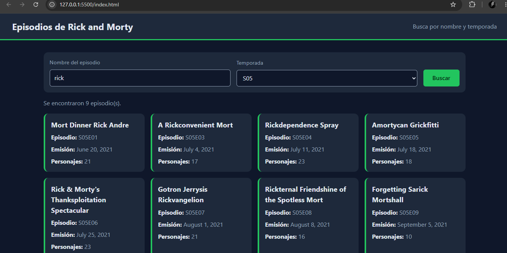

# Buscador de Episodios · Rick and Morty

Página web de una sola pantalla que permite buscar episodios de la serie *Rick and Morty* con la [API oficial](https://rickandmortyapi.com/documentation). Se busca por nombre y se filtra por temporada, y cada resultado se muestra en una tarjeta.

**Autor:** Osmar Ayala · Fundamentos de Desarrollo Web · UCSA
**Variante del TP:** C (Episodios)

## Sitios publicados

- GitHub Pages: https://OsDav99.github.io/tp-ayala-osmar/
- Vercel / Netlify: PEGAR-AQUI-LA-URL

## Captura



## Funcionalidades

- Búsqueda por nombre de episodio y filtro por temporada (S01 a S05), combinados en una sola petición.
- Tarjetas con nombre, código del episodio, fecha de emisión y cantidad de personajes.
- Mensajes de «Buscando…», «sin resultados» y error de conexión.
- Los valores vacíos o `unknown` se muestran como «Desconocido».
- La última búsqueda se guarda en `localStorage` y se repite al recargar.
- Diseño responsive con CSS Grid y Flexbox.

## Tecnologías

- HTML5, CSS3, JavaScript (ES6+), Fetch API, localStorage, API de Rick and Morty.

## Estructura del proyecto

```
tp-ayala-osmar/
├── index.html          Estructura de la página (header, buscador, resultados, footer)
├── README.md           Documentación del proyecto
├── .gitignore          Archivos excluidos del repositorio
├── css/
│   └── estilos.css     Estilos, variables, grilla de tarjetas y diseño responsive
├── js/
│   └── app.js          Lógica: petición a la API, tarjetas, estados y localStorage
└── img/
    └── captura.png     Captura usada en este README
```

## Cómo ejecutarlo localmente

1. `git clone https://github.com/OsDav99/tp-ayala-osmar.git`
2. Abrir `index.html` en el navegador (o con Live Server).

## Despliegue

El sitio se publica desde la rama `main` (carpeta raíz) en GitHub Pages y también en Vercel/Netlify. Ambas plataformas están conectadas al repositorio: cada `git push` a `main` actualiza las dos URL automáticamente, sin subir archivos a mano.

Proyecto académico de uso educativo.
